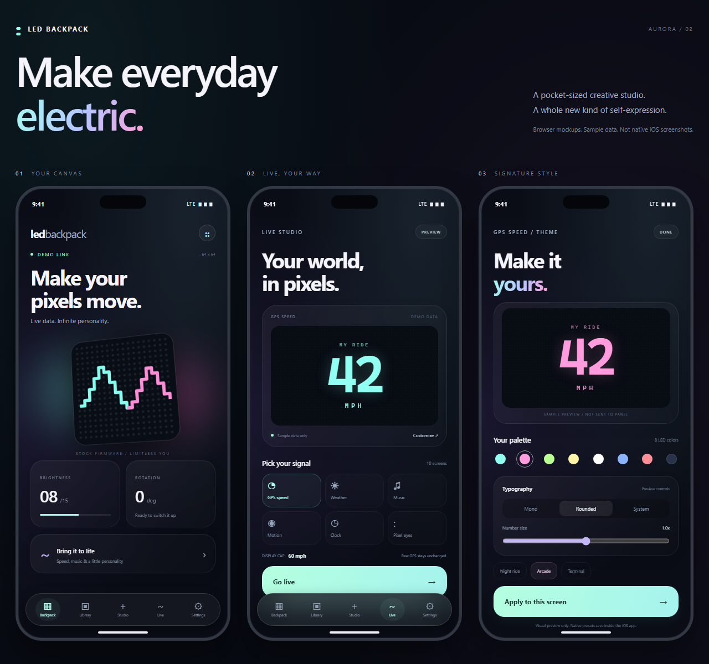

# LED Backpack

Independent native iOS controller for compatible Bluetooth LED backpacks,
built with SwiftUI and Core Bluetooth.



*Browser-rendered design mockup, not an iOS simulator screenshot.*

## What is included

- Backpack discovery, status, controls, storage slots and GIF uploads.
- Local image/GIF library, editing, background cleanup and animation timing.
- Crisp pixel-text/drawing tools and categorized Wikimedia Commons GIF browsing.
- Animated GIF previews, custom library categories, search and favorites.
- Live GPS, weather, supported system Music metadata and optional fun screens.
- Custom live themes, animated ink, gauges and saved presets.
- One-tap scenes combining live displays or stored playlists with brightness.
- A local expected-output monitor, not device pixel readback.
- Supported background GPS/BLE behavior and disconnect notifications.
- Local backups, Keychain passwords and diagnostics.

This repository contains the native iOS app, design assets and build workflows.

## Build

See the [iOS guide](ios/README.md) for setup, features and limitations.

On a Mac:

```sh
cd ios
brew install xcodegen
xcodegen generate
open LEDBackpack.xcodeproj
```

The [GitHub Actions workflow](.github/workflows/ios.yml) builds on macOS
and uploads an unsigned simulator app. Installing on an iPhone requires your
own Apple signing setup; a simulator ZIP cannot be installed on a phone.

For signed internal testing, see the [TestFlight setup guide](ios/TESTFLIGHT.md).
Its manual upload workflow requires protected environment secrets and explicit
confirmation; it never submits an App Store release automatically.

## Status and important limits

This is an experimental app. Installing a signed beta requires Apple signing
and a processed TestFlight build.

- Continuous arbitrary background timers are not guaranteed by iOS.
- Phone motion is not a validated motorcycle lean measurement.
- The output monitor shows expected/cached content, not physical pixel feedback.
- Uploading replaces the chosen backpack slot; unknown stored artwork cannot
  be backed up through a recovered readback command.
- Native iPhone Duo adaptation requires an appropriate iOS 27.1+ SDK.

Use the controls while stationary. Experimental live screens are supplemental,
not replacements for required lights or vehicle instruments.
